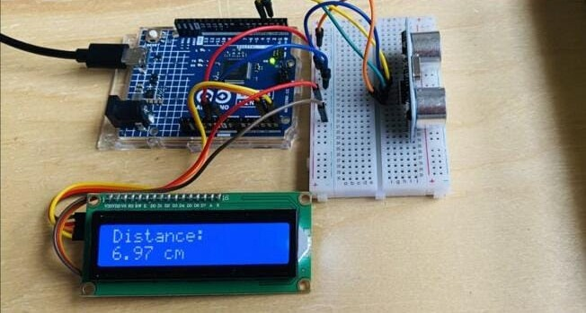
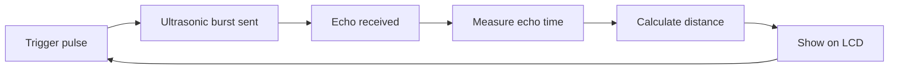

# Distance Measuring Device

[](https://whimsical-strudel-0f2465.netlify.app/)


An Arduino Uno based device that measures the distance to an object with an ultrasonic sensor and shows it in centimetres on a 16x2 LCD.

<p align="center">
  
  <br/><i>The working circuit, showing a reading of 6.97 cm</i>
</p>

---

## 📌 Overview

The ultrasonic sensor sends out a sound pulse and times how long the echo takes to return. The Arduino converts that time into a distance and prints it on the LCD, updating several times a second.

## ✨ Features

- Distance shown live on a 16x2 LCD (two decimal places, in cm)
- Shows "Out of range" when no object is detected
- Short, easy-to-read code

## 🧰 Components

| Component | Quantity |
|---|---|
| Arduino Uno | 1 |
| HC-SR04 ultrasonic sensor | 1 |
| 16x2 LCD with I2C module (4 wires) | 1 |
| Breadboard | 1 |
| Male-to-female jumper wires | as needed |
| USB cable (power and programming) | 1 |

## 🔌 Connections

| Part | Arduino pin |
|---|---|
| HC-SR04 VCC | 5V |
| HC-SR04 GND | GND |
| HC-SR04 TRIG | D9 |
| HC-SR04 ECHO | D10 |
| LCD VCC | 5V |
| LCD GND | GND |
| LCD SDA | A4 |
| LCD SCL | A5 |

On an Arduino Uno, the I2C LCD uses A4 (SDA) and A5 (SCL). The TRIG and ECHO pins can be changed at the top of the sketch to match your wiring.

## ⚙️ How It Works

1. The Arduino sends a 10 µs pulse to the TRIG pin.
2. The sensor emits an ultrasonic burst and raises the ECHO pin until the echo returns.
3. The Arduino measures how long ECHO stays high.
4. Distance = time × 0.0343 cm/µs ÷ 2 (the sound travels to the object and back).
5. The result is printed on the second line of the LCD.



## 🚀 How to Run

1. Install the **LiquidCrystal I2C** library (Arduino IDE → Tools → Manage Libraries).
2. Wire the circuit as in the table above.
3. Open `code/distance_meter/distance_meter.ino`.
4. Select **Tools → Board → Arduino Uno** and the correct port, then click **Upload**.
5. Move an object in front of the sensor and read the distance on the LCD.

If the LCD stays blank, change the address `0x27` to `0x3F` in the sketch, or turn the small contrast screw on the back of the LCD.

## 📁 Project Structure

```
Distance-Measuring-Device/
├── code/
│   └── distance_meter/
│       └── distance_meter.ino
├── images/
│   └── circuit.jpg
└── README.md
```

## 🔮 Possible Improvements

- Add a buzzer that beeps faster as an object gets closer
- Show the distance in inches as well
- Average several readings to smooth the result
- Add a temperature sensor to correct for the speed of sound

## 👩‍💻 Author

**Munazza Hawaldar**
E&TC Diploma, Government Polytechnic, Solapur (2026)
[LinkedIn](https://www.linkedin.com/in/munazza-hawaldar-644b0041a/) · [Portfolio](https://whimsical-strudel-0f2465.netlify.app/)
